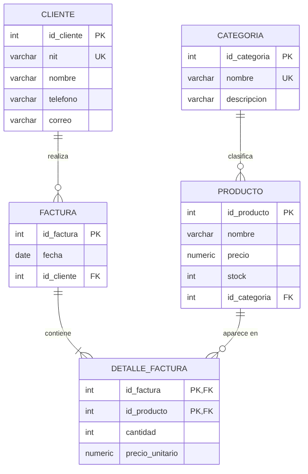
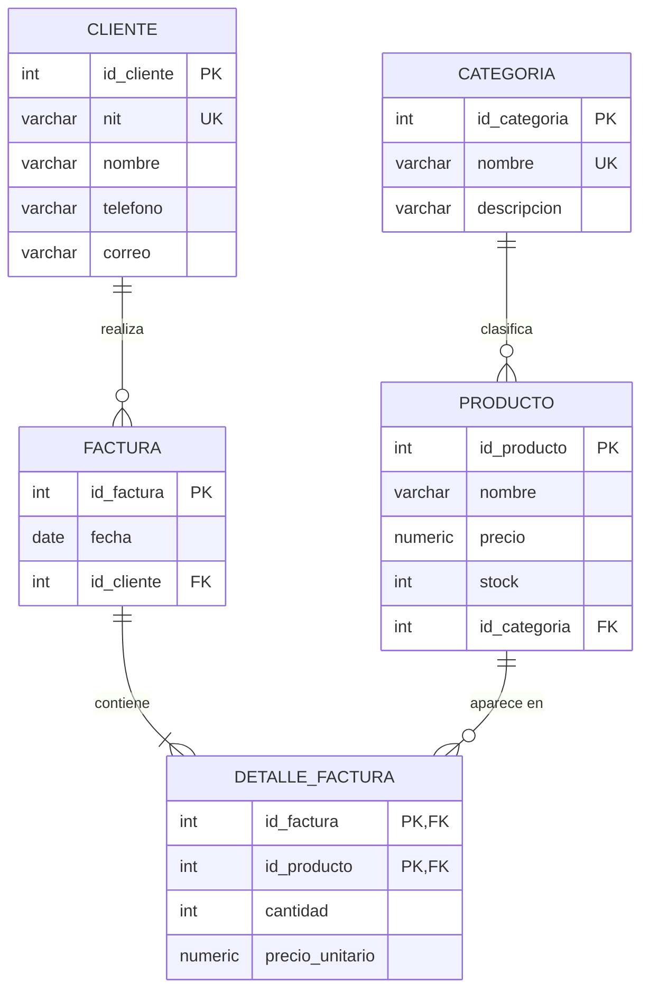

# Normalización paso a paso (0FN → 1FN → 2FN → 3FN)

Ejemplo: las facturas de una tienda de computadoras. Este es el mismo modelo que crea `database/schema.sql`.

---

## 0FN: tabla sin normalizar

Así anotaría las ventas alguien en una hoja de Excel:

| no_factura | fecha | nit_cliente | nombre_cliente | tel_cliente | productos | categorías | cantidades | precios |
|---|---|---|---|---|---|---|---|---|
| 1 | 2026-10-01 | 1234567-8 | Ana López | 5555-1111 | Laptop Lenovo, Mouse Logitech | Computadoras, Accesorios | 1, 2 | 4999.00, 95.00 |
| 2 | 2026-10-03 | 8765432-1 | Carlos Pérez | 5555-2222 | Monitor Samsung, Teclado Redragon | Monitores, Accesorios | 2, 1 | 1299.00, 375.00 |
| 3 | 2026-10-05 | 1234567-8 | Ana López | 5555-1111 | SSD Kingston | Almacenamiento | 3 | 650.00 |

**Problemas:**

- **Valores no atómicos**: una celda tiene varios productos ("Laptop, Mouse").
- **Redundancia**: los datos de Ana López se repiten en cada factura que hace.
- **Anomalías**:
  - *Inserción*: no puedo registrar un producto nuevo si nadie lo ha comprado.
  - *Actualización*: si Ana cambia de teléfono, tengo que cambiarlo en muchas filas (y si se me olvida una, quedan datos inconsistentes).
  - *Eliminación*: si borro la factura 2, pierdo que existe el "Monitor Samsung".

---

## 1FN: Primera Forma Normal

**Regla:** todos los valores son **atómicos** (un solo valor por celda), no hay grupos repetidos y la tabla tiene **llave primaria**.

**Qué hice:** una fila por cada producto de cada factura. Agregué `id_producto` y `id_categoria`.
**PK compuesta:** `(no_factura, id_producto)`

| **no_factura** | **id_producto** | fecha | nit_cliente | nombre_cliente | tel_cliente | nombre_producto | id_categoria | nombre_categoria | cantidad | precio_unitario |
|---|---|---|---|---|---|---|---|---|---|---|
| 1 | 1 | 2026-10-01 | 1234567-8 | Ana López | 5555-1111 | Laptop Lenovo | 1 | Computadoras | 1 | 4999.00 |
| 1 | 3 | 2026-10-01 | 1234567-8 | Ana López | 5555-1111 | Mouse Logitech | 2 | Accesorios | 2 | 95.00 |
| 2 | 6 | 2026-10-03 | 8765432-1 | Carlos Pérez | 5555-2222 | Monitor Samsung | 3 | Monitores | 2 | 1299.00 |
| 2 | 4 | 2026-10-03 | 8765432-1 | Carlos Pérez | 5555-2222 | Teclado Redragon | 2 | Accesorios | 1 | 375.00 |
| 3 | 7 | 2026-10-05 | 1234567-8 | Ana López | 5555-1111 | SSD Kingston | 4 | Almacenamiento | 3 | 650.00 |

Ya cumple 1FN, pero sigue habiendo mucha redundancia.

---

## 2FN: Segunda Forma Normal

**Regla:** estar en 1FN y que **no haya dependencias parciales**: cada atributo que no es llave debe depender de **toda** la PK, no solo de una parte.
(Solo puede pasar cuando la PK es compuesta.)

**Dependencias funcionales encontradas:**

| Depende de… | Atributos | ¿Parcial? |
|---|---|---|
| `no_factura` (solo una parte de la PK) | fecha, nit_cliente, nombre_cliente, tel_cliente | ✅ Sí → se separa |
| `id_producto` (solo una parte de la PK) | nombre_producto, id_categoria, nombre_categoria | ✅ Sí → se separa |
| `(no_factura, id_producto)` (PK completa) | cantidad, precio_unitario | ❌ No → se queda |

**Resultado 2FN:**

- **FACTURA**(<u>no_factura</u>, fecha, nit_cliente, nombre_cliente, tel_cliente)
- **PRODUCTO**(<u>id_producto</u>, nombre_producto, id_categoria, nombre_categoria)
- **DETALLE_FACTURA**(<u>no_factura</u>, <u>id_producto</u>, cantidad, precio_unitario)

---

## 3FN: Tercera Forma Normal

**Regla:** estar en 2FN y que **no haya dependencias transitivas**: un atributo no llave no puede depender de otro atributo no llave.
(A → B → C, donde B no es llave.)

**Dependencias transitivas encontradas:**

- En FACTURA: `no_factura → nit_cliente → nombre_cliente, tel_cliente`
  El nombre del cliente depende del NIT, no de la factura. → se crea **CLIENTE**
- En PRODUCTO: `id_producto → id_categoria → nombre_categoria`
  El nombre de la categoría depende de la categoría, no del producto. → se crea **CATEGORIA**

**Resultado final 3FN** (lo que está en `schema.sql`):

| Tabla | Llave primaria | Llaves foráneas | Otros atributos |
|---|---|---|---|
| **CATEGORIA** | id_categoria | — | nombre (UNIQUE), descripcion |
| **PRODUCTO** | id_producto | id_categoria → CATEGORIA | nombre, precio, stock |
| **CLIENTE** | id_cliente | — | nit (UNIQUE), nombre, telefono, correo |
| **FACTURA** | id_factura | id_cliente → CLIENTE | fecha |
| **DETALLE_FACTURA** | (id_factura, id_producto) | id_factura → FACTURA, id_producto → PRODUCTO | cantidad, precio_unitario |

> **Nota 1:** en CLIENTE usé un `id_cliente` autoincremental como PK (llave sustituta) y dejé el `nit` como `UNIQUE`. Así, si el NIT se escribió mal, se corrige sin romper las facturas.
>
> **Nota 2:** `precio_unitario` en DETALLE_FACTURA **no** es redundancia: es el precio *al momento de la venta*. Si mañana sube el precio del producto, las facturas viejas no deben cambiar.
>
> **Nota 3:** como PRODUCTO, CLIENTE y CATEGORIA ya son tablas propias, les agregué atributos que la tienda necesita (precio de catálogo, stock, correo, descripción). Agregarlos no rompe la 3FN porque cada uno depende solo de la PK de su tabla.

### Diagrama entidad-relación

Código Mermaid del diagrama (se ve en GitHub)

---

## Resumen para el examen

| Concepto | En una línea |
|---|---|
| **Dependencia funcional** (A → B) | Si conozco A, conozco B con certeza. Ej.: `nit → nombre_cliente` |
| **1FN** | Valores atómicos, sin grupos repetidos, con PK. |
| **2FN** | 1FN + ningún atributo depende solo de una *parte* de la PK compuesta. |
| **3FN** | 2FN + ningún atributo no llave depende de otro atributo no llave. |
| **PK** | Identifica cada fila de forma única; no se repite ni es NULL. |
| **FK** | Columna que apunta a la PK de otra tabla; garantiza integridad referencial. |
| **Anomalías** | Problemas de inserción, actualización y eliminación causados por redundancia. |

**Truco para encontrar dependencias:** para cada columna pregúntate *"¿de qué necesito saber el valor para saber este dato?"*. Si la respuesta es solo una parte de la PK → viola 2FN. Si es otra columna que no es PK → viola 3FN.
